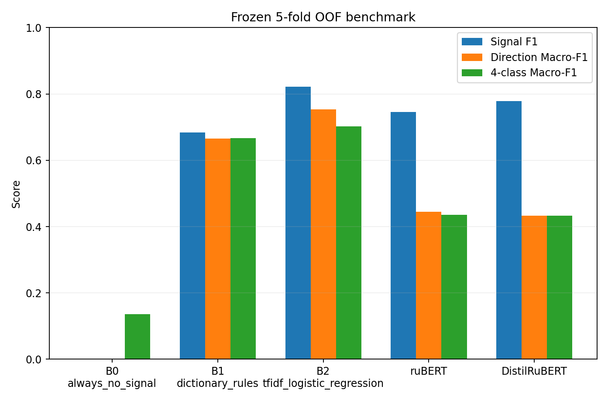
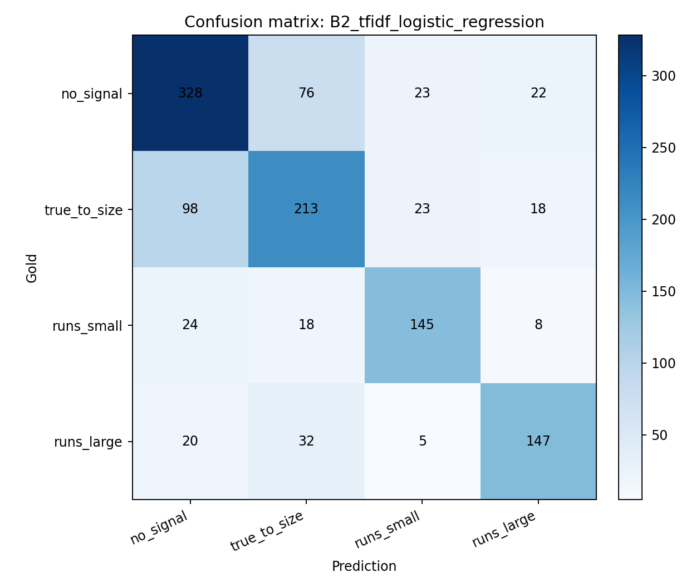
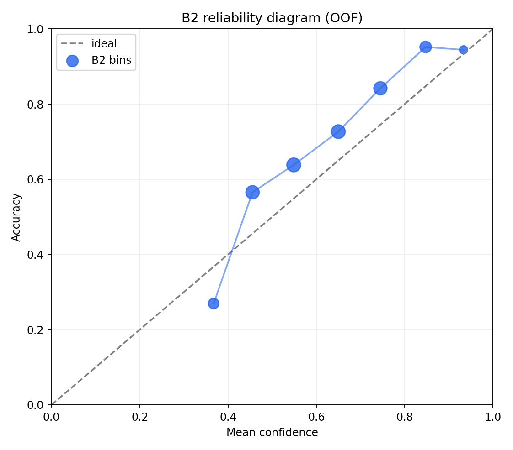
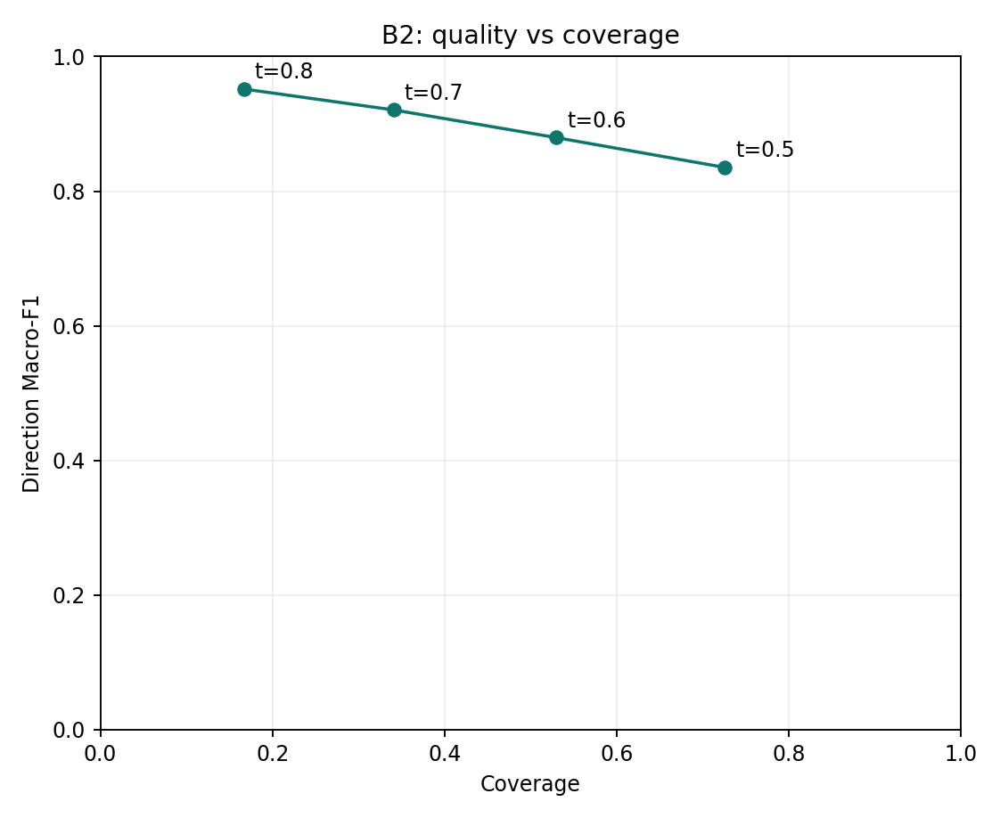

# Frozen review-level benchmark: итог выбора модели

Дата запуска: `2026-10-24`. Все числа ниже получены как out-of-fold predictions на заранее замороженных пяти group-folds; одна товарная группа не пересекает train и validation.

## Сравнение моделей

| Model | Signal F1 | Direction Macro-F1 | 4-class Macro-F1 | Accuracy | Direction fold mean ± std | ECE | Size, bytes |
|---|---:|---:|---:|---:|---:|---:|---:|
| `B0_always_no_signal` | 0.000 | 0.000 | 0.136 | 0.374 | 0.000 ± 0.000 | 0.626 | 0 |
| `B1_dictionary_rules` | 0.684 | 0.665 | 0.667 | 0.677 | 0.661 ± 0.035 | 0.323 | 0 |
| `B2_tfidf_logistic_regression` | 0.822 | 0.754 | 0.702 | 0.694 | 0.752 ± 0.027 | 0.091 | 995,210 |
| `ruBERT` | 0.745 | 0.445 | 0.435 | 0.458 | 0.444 ± 0.030 | 0.394 | 711,455,574 |
| `DistilRuBERT` | 0.779 | 0.433 | 0.432 | 0.460 | 0.430 ± 0.045 | 0.252 | 41,190,820 |

По заранее выбранной основной метрике лидирует B2. Для ruBERT и DistilRuBERT использован зафиксированный CPU-доступный режим frozen CLS encoder + class-balanced Logistic Regression; это не full fine-tuning.

## Ошибки B2

Основная метрика B2 — Direction Macro-F1 `0.754`. По классам направления: `true_to_size` F1 `0.693`, `runs_small` F1 `0.788`, `runs_large` F1 `0.780`. Главная слабость — `true_to_size`: 98 из 352 таких отзывов модель ошибочно относит к `no_signal`.

## Confidence и abstain

Для B2 ECE на 10 интервалах равен `0.091`, multiclass Brier score — `0.427`. Это диагностические показатели raw confidence, а не доказательство идеальной калибровки.

| Threshold | Coverage | Direction Macro-F1 | Signal F1 | Accuracy |
|---:|---:|---:|---:|---:|
| 0.5 | 0.726 | 0.835 | 0.867 | 0.782 |
| 0.6 | 0.530 | 0.880 | 0.897 | 0.835 |
| 0.7 | 0.341 | 0.921 | 0.936 | 0.895 |
| 0.8 | 0.167 | 0.952 | 0.978 | 0.950 |

## Informativeness (служебная модель для будущей агрегации)

| Model | High F1 | High precision | High recall | Macro-F1 | PR-AUC high |
|---|---:|---:|---:|---:|---:|
| `I0_always_not_high` | 0.000 | 0.000 | 0.000 | 0.437 | 0.225 |
| `I1_tfidf_logistic_regression` | 0.526 | 0.502 | 0.552 | 0.689 | 0.511 |

Цель информативности получена из уже имеющихся полей разметки и не является отдельным независимым Gold Standard. Поэтому её используем только для простого exploratory-веса `high = 2`, `not_high = 1` на item-level этапе.

## Замороженное решение

- Выбрана `B2_tfidf_logistic_regression`: Direction Macro-F1 `0.754`, Signal F1 `0.822`.
- Raw maximum probability сохраняется как некалиброванный confidence score.
- Единственная граница `0.60`: прогноз принимается при `confidence >= 0.60`, иначе `abstain`.
- На WB OOF при этом coverage `0.530`, Direction Macro-F1 принятой части `0.880`.
- Модель, артефакт и порог записаны в `research/config/frozen_review_model_v1.json`.
- Яндекс Маркет не используется для выбора модели или порога.
